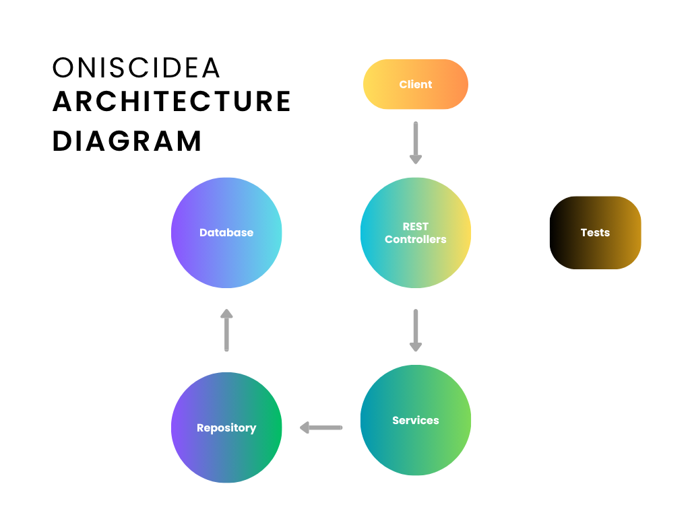
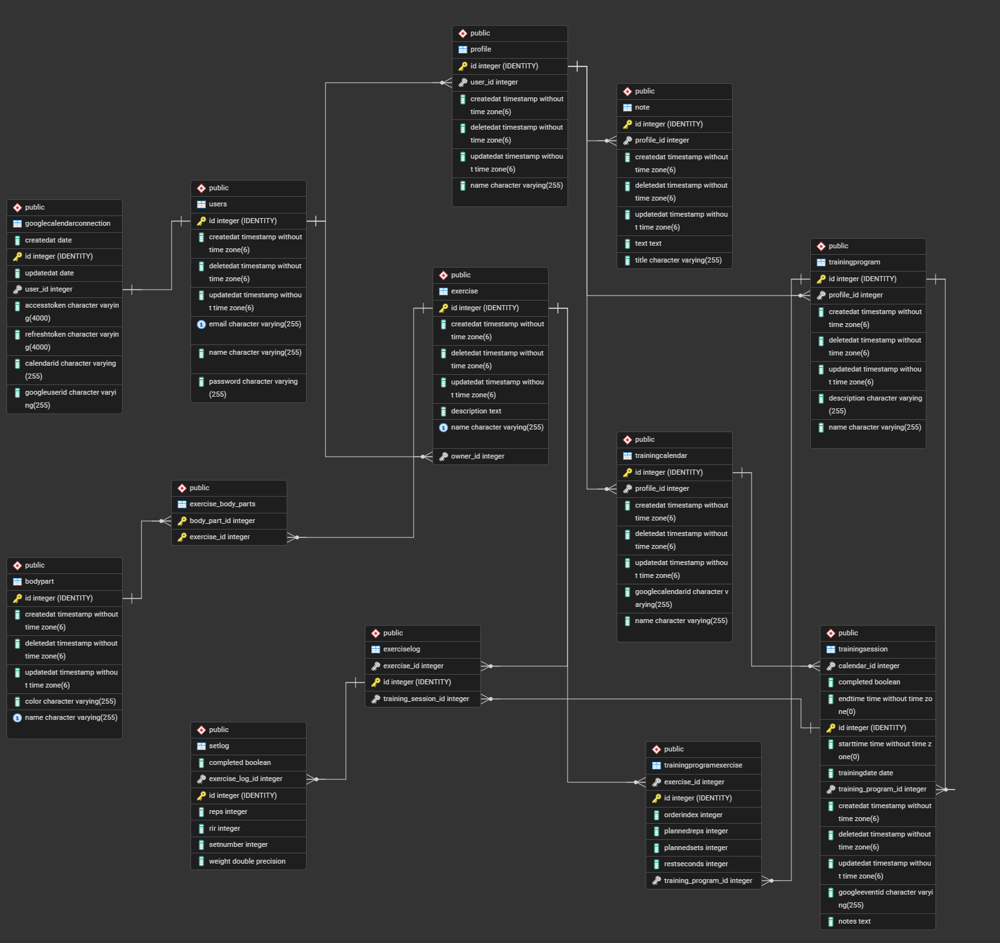

# Oniscidea

## Project Overview

### Vision

Oniscidea is a backend API for planning and tracking strength training. Users can organize profiles, calendars, training programs, exercises, and workout logs, while connecting training sessions to Google Calendar for scheduling synchronization.

### Links

- **Deployed API:** https://api.oniscidea.dk
- **Source code repository:** https://github.com/Eligoon/Oniscidea
- **Portfolio website:** https://eligoon.github.io/portfolio-2026/

## Architecture

### System overview

Oniscidea is a Java REST API. HTTP requests are handled by controllers, business rules and workflows are implemented in services, and DAOs provide database access through JPA/Hibernate. The application uses PostgreSQL for data persistance and JWT authentication for protected API routes.

The project also integrates with Google Calendar using Google's Calendar API and OAuth credentials. A training session stores its Google event ID so the application can update or delete the corresponding event when the session changes. Google Calendar synchronization depends on a user having connected their Google account and on the training calendar having a Google Calendar ID.

### Application structure

- **Controllers (`app.controllers`)** — map HTTP routes to application operations and translate requests and responses.
- **Services (`app.services`)** — contain business logic for users, profiles, training calendars and sessions, programs, exercises, logs, notes, and Google Calendar integration.
- **DAOs (`app.daos`)** — handle persistence and retrieval through the JPA entity manager.
- **Entities (`app.entities`)** — represent the domain model and its database relationships.
- **DTOs (`app.dtos`)** — define request and response data shapes.
- **Authentication** — `JwtService` creates/handles JWTs and `JwtAuthentication` protects API routes.
- **Tests (`src/test`)** — automated tests for service behavior.

### Technologies

- Java 25 (project configuration)
- Javalin
- JPA / Hibernate
- PostgreSQL
- Maven
- JWT authentication
- Google Calendar API and OAuth 2.0
- JUnit and the testing tools configured in the project
- Docker for deployment
- Git and GitHub for version control

### Architecture diagram



### Key design decisions

**Layered architecture.** Controllers, services, DAOs, and entities have separate responsibilities. This keeps HTTP handling separate from business logic and database operations, making the application easier to maintain and test.

**JWT authentication.** The login endpoint issues a token. Protected `/api/` routes require authentication; registration, login, the Google OAuth callback, and selected public read endpoints are exceptions.

**DTOs for the API.** Request and response DTOs keep API payloads separate from the persistence entities.

**Google Calendar integration.** Google Calendar is integrated through a dedicated service. The Google event ID is stored on a training session so that the external event can be matched to the local session. Calendar IDs are stored on training calendars, allowing a session to target a particular Google calendar.

**Centralized error handling.** The Javalin application maps API exceptions to HTTP status codes and structured error responses. Invalid JSON receives a `400` response, and unexpected exceptions are logged and return a generic `500` response.

## Data Model

### ERD



### Important entities and relationships

- **User** — registered account with a name, email, password, timestamps, and one or more profiles.
- **Profile** — belongs to a user. A profile groups that user's training calendars, training programs, and notes.
- **TrainingCalendar** — belongs to a profile and contains training sessions. It can store a `googleCalendarId` when linked to Google Calendar.
- **TrainingSession** — belongs to a training calendar and a training program. It stores the date, start and end times, completion state, notes, and optional `googleEventId`. A session can have exercise logs.
- **TrainingProgram** — belongs to a profile and contains ordered training-program exercises.
- **TrainingProgramExercise** — joins a training program to an exercise and stores its order and planned sets, reps, and rest time.
- **Exercise** — stores an exercise name and description. It can be a shared exercise or owned by a user, and it can be associated with multiple body parts.
- **BodyPart** — has a name and color and can be associated with multiple exercises.
- **ExerciseLog** — records an exercise performed in a training session and belongs to that session and an exercise. It contains set logs.
- **SetLog** — records an individual set, including set number, weight, reps, RIR (reps in reserve), and completion state.
- **Note** — a titled text note belonging to a profile.
- **GoogleCalendarConnection** — stores the user's Google Calendar connection details used by the integration.

The main ownership path is `User → Profile → TrainingCalendar → TrainingSession`. Profiles also own training programs and notes. Training sessions reference a training program; programs connect to exercises through `TrainingProgramExercise`. Workout results are recorded through `TrainingSession → ExerciseLog → SetLog`. Exercises and body parts have a many-to-many relationship.

## API Documentation

All application endpoints use the `/api` prefix. Except for the public routes described below, requests must include a valid JWT in the `Authorization` header using the `Bearer <token>` format. The exact JSON fields for each operation are defined by the corresponding DTOs.

### Authentication and users

| Method | Endpoint | Purpose |
|---|---|---|
| `POST` | `/api/users` | Register a user |
| `POST` | `/api/login` | Log in and receive authentication credentials |
| `GET` | `/api/users` | List users (authenticated) |
| `GET` | `/api/users/{id}` | Get a user |
| `PUT` | `/api/users/{id}` | Update a user |
| `DELETE` | `/api/users/{id}` | Delete a user |

### Profiles

| Method | Endpoint | Purpose |
|---|---|---|
| `POST` | `/api/profiles` | Create a profile |
| `GET` | `/api/profiles` | List profiles |
| `GET` | `/api/profiles/{id}` | Get a profile |
| `PUT` | `/api/profiles/{id}` | Update a profile |
| `DELETE` | `/api/profiles/{id}` | Delete a profile |

### Training programs and exercises in programs

| Method | Endpoint | Purpose |
|---|---|---|
| `POST` | `/api/training-programs` | Create a training program |
| `GET` | `/api/training-programs` | List training programs |
| `GET` | `/api/training-programs/{id}` | Get a training program |
| `PUT` | `/api/training-programs/{id}` | Update a training program |
| `DELETE` | `/api/training-programs/{id}` | Delete a training program |
| `POST` | `/api/training-programs/{id}/exercises` | Add an exercise to a program |
| `DELETE` | `/api/training-programs/{id}/exercises/{exerciseId}` | Remove an exercise from a program |

### Training calendars and sessions

| Method | Endpoint | Purpose |
|---|---|---|
| `POST` | `/api/calendars` | Create a training calendar |
| `GET` | `/api/calendars` | List training calendars |
| `GET` | `/api/calendars/{id}` | Get a calendar |
| `PUT` | `/api/calendars/{id}` | Update a calendar |
| `DELETE` | `/api/calendars/{id}` | Delete a calendar |
| `POST` | `/api/training-sessions` | Create a training session |
| `GET` | `/api/training-sessions` | List training sessions |
| `GET` | `/api/training-sessions/{id}` | Get a session |
| `PUT` | `/api/training-sessions/{id}` | Update a session |
| `DELETE` | `/api/training-sessions/{id}` | Delete a session |

Example request to create a training session:

```http
POST /api/training-sessions
Content-Type: application/json
Authorization: Bearer <token>
```

```json
{
  "calendarId": 4,
  "trainingProgramId": 1,
  "date": "2026-11-06",
  "startTime": "10:00:00",
  "endTime": "10:45:00"
}
```

A successful response includes the created session's ID and its fields. When Google Calendar synchronization is configured for the selected calendar, the response also includes the `googleEventId` for the linked event.

### Exercises and body parts

| Method | Endpoint | Purpose |
|---|---|---|
| `POST` | `/api/exercises` | Create an exercise |
| `GET` | `/api/exercises` | List exercises |
| `GET` | `/api/exercises/{id}` | Get an exercise |
| `PUT` | `/api/exercises/{id}` | Update an exercise |
| `DELETE` | `/api/exercises/{id}` | Delete an exercise |
| `POST` | `/api/exercises/{id}/body-parts/{bodyPartId}` | Associate a body part with an exercise |
| `DELETE` | `/api/exercises/{id}/body-parts/{bodyPartId}` | Remove a body-part association |
| `POST` | `/api/body-parts` | Create a body part |
| `GET` | `/api/body-parts` | List body parts |
| `GET` | `/api/body-parts/{id}` | Get a body part |
| `PUT` | `/api/body-parts/{id}` | Update a body part |
| `DELETE` | `/api/body-parts/{id}` | Delete a body part |

### Logs and notes

| Method | Endpoint | Purpose |
|---|---|---|
| `POST` | `/api/training-sessions/{id}/logs` | Create an exercise log for a session |
| `GET` | `/api/exercise-logs/{id}` | Get an exercise log |
| `POST` | `/api/exercise-logs/{id}/sets` | Create a set log |
| `GET` | `/api/set-logs/{id}` | Get a set log |
| `POST` | `/api/notes` | Create a note |
| `GET` | `/api/notes` | List notes |
| `GET` | `/api/notes/{id}` | Get a note |
| `PUT` | `/api/notes/{id}` | Update a note |
| `DELETE` | `/api/notes/{id}` | Delete a note |

### Google Calendar

| Method | Endpoint | Purpose |
|---|---|---|
| `GET` | `/api/google-calendar/connect` | Start the Google OAuth connection flow |
| `GET` | `/api/google-calendar/callback` | Handle the Google OAuth callback |
| `POST` | `/api/google-calendar/events` | Create a Google Calendar event directly |
| `PUT` | `/api/google-calendar/events/{eventId}` | Update a Google Calendar event directly |
| `DELETE` | `/api/google-calendar/events/{eventId}` | Delete a Google Calendar event directly |

Training-session create, update, and delete operations also synchronize linked events when the session's calendar is connected to Google Calendar. This behavior was manually verified against the deployed API: event creation, updating an existing event, and deleting the linked event all worked in the test session.

### Other API behavior

- `GET /` returns a simple message indicating that the API is running.
- `GET /api/exercises` and `GET /api/body-parts` are configured as public read endpoints, as are `GET /api/exercises/{id}` and `GET /api/body-parts/{id}`. Registration, login, and the Google OAuth callback are also public routes.
- API errors use HTTP status codes and JSON error responses. A missing training session returns `404`.

## User Stories

- As a user, I want to register an account.
- As a user, I want to log in and out, and receive a token.
- As a user, I want to be able to pick or create a training session on a calendar.
- As a user, I want body parts in an exercise to be color coded.
- As a user, I want to be able to write notes for my training sessions.
- As a user, I want to be able to mark if I've done my training or not.
- As a user, I want to be able to write separate notes from training sessions.
- As a user, I want to be able to have several profiles which each have their calendars and notes.
- As a user, I want to view RIR (reps in reserve) and have it calculated automatically.

## Development Notes

The project separates API handling, business logic, and persistence into different layers. One important integration challenge was keeping a training session and its Google Calendar event synchronized. The session stores the external Google event ID, and the deployed integration was manually tested for creating a session, changing the event time, and deleting the session and its event.

For local development, configure the database connection and Google OAuth client settings outside source control. Never commit real passwords, OAuth client secrets, access tokens, or refresh tokens.
